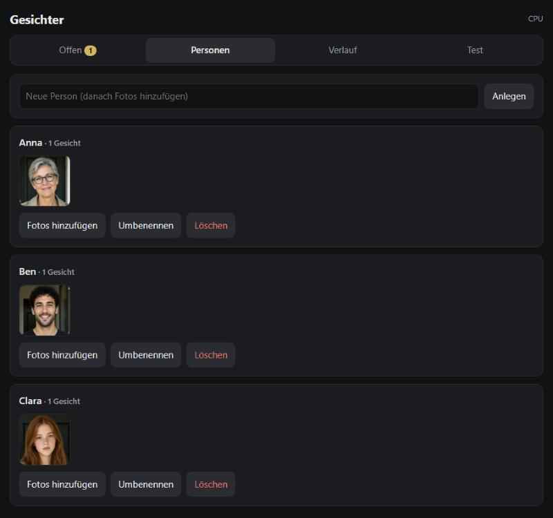
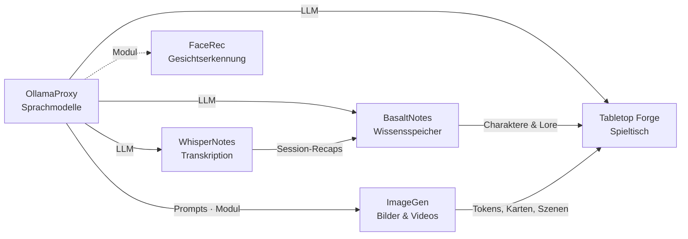

# FaceRec

🇬🇧 [English](README.md) · 🇩🇪 Deutsch

> Lokale Gesichtserkennung für die Türklingel in Home Assistant – die Augen an der Tür der Poldion-Familie.

**Lizenz:** MIT · **Sprache:** Python (FastAPI, ONNX Runtime) · **Läuft auf:** Linux, CPU oder AMD-GPU (ROCm) ·
**Teil von:** [Poldion Self-Hosted](#die-poldion-familie)



## Überblick

Ein kleiner Dienst (Port 8191), der beim Klingeln das Bild aus Home Assistant bekommt, die Gesichter erkennt und
einen Satz zurückgibt – „Anna steht vor der Tür.“ Unbekannte Gesichter landen unter „Offen“ und werden per Push-Knopf
oder in der Oberfläche einer Person zugewiesen. So lernt der Dienst dazu. Alles bleibt lokal.

## Funktionen

| Bereich | Was es kann |
|---|---|
| **Erkennen** | InsightFace `buffalo_l` (SCRFD + ArcFace) direkt über ONNX Runtime, ~90 ms auf der CPU, wenige ms auf der GPU |
| **Lernen** | Unbekannte zuweisen (ähnliche werden gruppiert), per Foto anlernen, umbenennen, zusammenlegen |
| **Korrigieren** | „Falsch erkannt“ per Push-Knopf oder im Verlauf; erkannte Gesichter bleiben dafür 48 h |
| **Stream-Scan** | Liest einen MJPEG-Stream (z. B. ESP32-Kamera) für einige Sekunden und verfolgt jedes Gesicht als Spur |
| **Home Assistant** | Paket mit `rest_command` und Sensoren, Vorlagen für die Automationen |
| **OllamaProxy-Modul** | Erscheint mit Link und Speicher in der Oberfläche des [OllamaProxy](https://github.com/Poldion/OllamaProxy) (`/proxy-module`) |
| **Oberfläche** | Offene Gesichter, Personen, Verlauf, Test-Upload; auf Deutsch und Englisch |

## Schnellstart

```bash
git clone https://github.com/Poldion/FaceRec.git && cd FaceRec
mkdir -p ~/facerec/data && cp facerec.env.example ~/facerec/facerec.env   # HA_URL und HA_TOKEN eintragen
chmod 600 ~/facerec/facerec.env
docker compose --env-file ~/facerec/facerec.env up -d --build
# mit AMD-GPU:
docker compose -f docker-compose.yml -f docker-compose.rocm.yml --env-file ~/facerec/facerec.env up -d --build
```

Oberfläche: `http://<host>:8191/`. In Home Assistant das Paket [homeassistant/facerec.yaml](homeassistant/facerec.yaml)
nach `/config/packages/` kopieren und `FACEREC_HOST` darin ersetzen. Die Automationen in
[homeassistant/automations.yaml](homeassistant/automations.yaml) sind eine Vorlage für die eigenen Entitäten.

## Konfiguration

| Variable | Standard | Bedeutung |
|---|---|---|
| `HA_URL` / `HA_TOKEN` | – | Home Assistant und ein Long-Lived Token zum Abholen der Bilder |
| `FACEREC_TOKEN` | – | Optionaler Schlüssel für API und Oberfläche |
| `FACEREC_MATCH` / `FACEREC_SUGGEST` | `0.32` / `0.28` | Schwellen für „erkannt“ und „Vorschlag“ |
| `FACEREC_RECENT_HOURS` | `48` | So lange bleiben erkannte Gesichter zum Korrigieren |
| `FACEREC_LANG` | `de` | Sprache des Ansage- und Push-Satzes (`de` oder `en`); die Oberfläche hat einen eigenen Umschalter |
| `FACEREC_PROVIDERS` | `CPUExecutionProvider` | ONNX-Rechenwerk (GPU/NPU) |
| `FACEREC_STREAM_URLS` | – | Stream-Scan: eigene MJPEG-Adressen je Kamera, z. B. `camera.flur=http://192.168.1.50:8080/` |
| `RENDER_GID` / `VIDEO_GID` | `992` / `44` | Nur ROCm-Variante: GPU-Gruppen des Hosts |

## Datenschutz

Gesichtsdaten sind biometrische Daten. Betreibe den Dienst nur im eigenen Netz, informiere Besucher über die Kamera
und beachte die geltenden Datenschutzgesetze (in der EU die DSGVO). Erkannte Gesichter werden nach 48 h automatisch
gelöscht. Unbekannte bleiben, bis du sie zuweist oder verwirfst. `facerec.env` enthält das Home-Assistant-Token
(Rechte `600`), die Daten liegen in `data/` (SQLite + JPEGs) – beim Backup entsprechend schützen.

## Zusammenspiel mit der Poldion-Familie

- **[OllamaProxy](https://github.com/Poldion/OllamaProxy)** zeigt FaceRec als Modul: Link zur Oberfläche und
  Speicherverbrauch (Eintrag in seiner `modules.json`: `{"url": "http://host.docker.internal:8191"}`).
- **Home Assistant** liefert das Klingelbild bzw. den Kamera-Stream und spricht das Ergebnis an der Tür aus.

## Die Poldion-Familie

Sechs selbst gehostete Projekte, die einzeln funktionieren und zusammen ein Ganzes ergeben:



| Projekt | Rolle |
|---|---|
| [OllamaProxy](https://github.com/Poldion/OllamaProxy) | KI-Zentrale: Sprachmodelle mit festen Einstellungen, Module für weitere Dienste |
| [ImageGen](https://github.com/Poldion/ImageGen) | Bilder und Videos mit ComfyUI, Web-App und API |
| **FaceRec** (dieses Repository) | Gesichtserkennung an der Türklingel für Home Assistant |
| [WhisperNotes](https://github.com/Poldion/WhisperNotes) | Transkription, Sprechererkennung, Zusammenfassungen und D&D-Recaps |
| [BasaltNotes](https://github.com/Poldion/BasaltNotes) | Notizen und Welt-Wiki mit KI-Kurator |
| [Tabletop Forge](https://github.com/Poldion/TabletopForge) | Digitaler Spieltisch und Kampagnenverwaltung für 5e |

## Dokumentation

- [docs/technik.md](docs/technik.md) – Modelle, Messwerte, Stream-Scan, Home-Assistant-Anbindung, API (Englisch: [technik.en.md](docs/technik.en.md))
- [CHANGELOG.md](CHANGELOG.md) – Versionsverlauf (nur Englisch)
- [CONTRIBUTING.md](CONTRIBUTING.md) – Entwicklungsumgebung, Tests, Regeln (nur Englisch, mit deutschem Abschnitt)
- [SECURITY.md](SECURITY.md) – Sicherheitslücken melden (nur Englisch)

## Entwicklung

```bash
./run_tests.sh   # Tests im Container mit nachgebautem Erkenner
```

## Lizenz & Drittanbieter

Der Code steht unter der [MIT-Lizenz](LICENSE). **Die Modelle von InsightFace (`buffalo_l`) sind nur für
nicht-kommerzielle Forschung freigegeben.** Sie werden beim Bau des Images heruntergeladen und nicht mitgeliefert. Für
eine kommerzielle Nutzung brauchst du eine Lizenz von InsightFace oder andere Modelle. Übersicht:
[THIRD_PARTY_NOTICES.md](THIRD_PARTY_NOTICES.md).

## Unterstützen

Wenn dir das Projekt hilft, freue ich mich über Rückmeldungen, Fehlerberichte und Pull Requests – siehe
[CONTRIBUTING.md](CONTRIBUTING.md).
Du kannst mir auch [einen Kaffee ausgeben](https://buymeacoffee.com/poldion).
