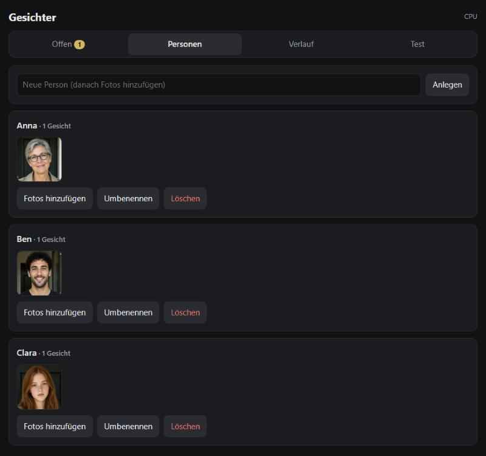
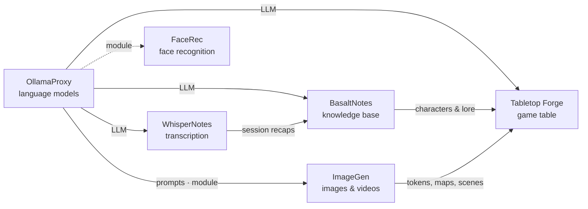

# FaceRec

🇬🇧 English · 🇩🇪 [Deutsch](README.de.md)

> Local face recognition for the doorbell in Home Assistant – the eyes at the door of the Poldion family.

**License:** MIT · **Language:** Python (FastAPI, ONNX Runtime) · **Runs on:** Linux, CPU or AMD GPU (ROCm) ·
**Part of:** [Poldion Self-Hosted](#the-poldion-family)



## Overview

A small service (port 8191) that receives the doorbell image from Home Assistant when someone rings, recognizes the
faces and returns a sentence – "Anna is at the door." (or in German with `FACEREC_LANG=de`, the default). Unknown faces end up under "Offen"
(open) and are assigned to a person via a push notification button or in the UI. That's how the service learns.
Everything stays local.

## Features

| Area | What it does |
|---|---|
| **Recognition** | InsightFace `buffalo_l` (SCRFD + ArcFace) directly via ONNX Runtime, ~90 ms on the CPU, a few ms on the GPU |
| **Learning** | Assign unknown faces (similar ones are grouped), learn from photos, rename, merge |
| **Correcting** | "Wrongly recognized" via push button or in the history; recognized faces are kept for 48 h for that |
| **Stream scan** | Reads an MJPEG stream (e.g. ESP32 camera) for a few seconds and tracks every face |
| **Home Assistant** | Package with `rest_command` and sensors, templates for the automations |
| **OllamaProxy module** | Shows up with link and memory in the [OllamaProxy](https://github.com/Poldion/OllamaProxy) UI (`/proxy-module`) |
| **UI** | Open faces, people, history, test upload; in English and German |

## Quick start

```bash
git clone https://github.com/Poldion/FaceRec.git && cd FaceRec
mkdir -p ~/facerec/data && cp facerec.env.example ~/facerec/facerec.env   # set HA_URL and HA_TOKEN
chmod 600 ~/facerec/facerec.env
docker compose --env-file ~/facerec/facerec.env up -d --build
# with an AMD GPU:
docker compose -f docker-compose.yml -f docker-compose.rocm.yml --env-file ~/facerec/facerec.env up -d --build
```

UI: `http://<host>:8191/`. In Home Assistant, copy the package [homeassistant/facerec.yaml](homeassistant/facerec.yaml)
to `/config/packages/` and replace `FACEREC_HOST` in it. The automations in
[homeassistant/automations.yaml](homeassistant/automations.yaml) are a template for your own entities.

## Configuration

| Variable | Default | Meaning |
|---|---|---|
| `HA_URL` / `HA_TOKEN` | – | Home Assistant and a long-lived token to fetch the images |
| `FACEREC_TOKEN` | – | Optional key for API and UI |
| `FACEREC_MATCH` / `FACEREC_SUGGEST` | `0.35` / `0.28` | Thresholds for "recognized" and "suggestion" |
| `FACEREC_KEEP_EVENTS` | `300` | History entries kept per camera |
| `FACEREC_RECENT_HOURS` | `48` | How long recognized faces are kept for corrections |
| `FACEREC_LANG` | `de` | Language of the announcement and push sentence (`de` or `en`); the UI has its own switch |
| `FACEREC_PROVIDERS` | `CPUExecutionProvider` | ONNX execution provider (GPU/NPU) |
| `FACEREC_STREAM_URLS` | – | Stream scan: own MJPEG URLs per camera, e.g. `camera.hall=http://192.168.1.50:8080/` |
| `RENDER_GID` / `VIDEO_GID` | `992` / `44` | ROCm variant only: GPU groups of the host |

## Privacy

Face data is biometric data. Run the service in your own network only, tell visitors about the camera and follow the
applicable data protection laws (in the EU the GDPR). Recognized faces are deleted automatically after 48 h. Unknown
faces stay until you assign or discard them. `facerec.env` contains the Home Assistant token (permissions `600`), the
data lives in `data/` (SQLite + JPEGs) – protect your backups accordingly.

## Working with the Poldion family

- **[OllamaProxy](https://github.com/Poldion/OllamaProxy)** shows FaceRec as a module: link to the UI and memory use
  (entry in its `modules.json`: `{"url": "http://host.docker.internal:8191"}`).
- **Home Assistant** delivers the doorbell image or camera stream and announces the result at the door.

## The Poldion family

Six self-hosted projects that work on their own and form a whole together:



| Project | Role |
|---|---|
| [OllamaProxy](https://github.com/Poldion/OllamaProxy) | AI hub: language models with fixed settings, modules for other services |
| [ImageGen](https://github.com/Poldion/ImageGen) | Images and videos with ComfyUI, web app and API |
| **FaceRec** (this repository) | Face recognition at the doorbell for Home Assistant |
| [WhisperNotes](https://github.com/Poldion/WhisperNotes) | Transcription, speaker detection, summaries and D&D recaps |
| [BasaltNotes](https://github.com/Poldion/BasaltNotes) | Notes and world wiki with an AI curator |
| [Tabletop Forge](https://github.com/Poldion/TabletopForge) | Digital game table and campaign management for 5e |

## Documentation

- [docs/technik.en.md](docs/technik.en.md) – models, measurements, stream scan, Home Assistant integration, API (German: [technik.md](docs/technik.md))
- [CHANGELOG.md](CHANGELOG.md) – version history
- [CONTRIBUTING.md](CONTRIBUTING.md) – development setup, tests, guidelines, translations
- [SECURITY.md](SECURITY.md) – reporting security issues

## Development

```bash
./run_tests.sh   # tests in a container with a simulated recognizer
```

## License & third parties

The code is licensed under the [MIT License](LICENSE). **The InsightFace models (`buffalo_l`) are released for
non-commercial research only.** They are downloaded when the image is built and are not included. For commercial use
you need a license from InsightFace or other models. Overview: [THIRD_PARTY_NOTICES.md](THIRD_PARTY_NOTICES.md).

## Support

If the project helps you, I'm happy about feedback, bug reports and pull requests – see [CONTRIBUTING.md](CONTRIBUTING.md).
You can also [buy me a coffee](https://buymeacoffee.com/poldion).
